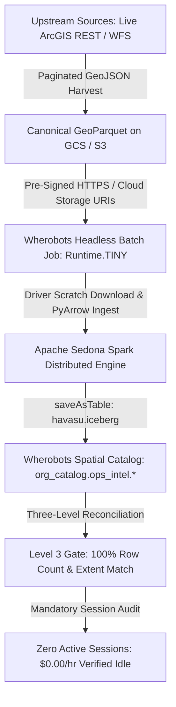

# Wherobots Cloud Library Migration & Batch Export Playbook

## Summary

This playbook provides an end-to-end, zero-mock recipe for migrating large geospatial libraries—authoritative foundation datasets, hazard layers, cadastral boundaries, and live REST/WFS web services—into **Wherobots Cloud** (Apache Sedona + Havasu / Apache Iceberg catalog) with **$0.00/hr idle cost control** and **Three-Level QA Reconciliation**.

Use this playbook whenever you need to export or sync a geospatial dataset library from local disk, Google Cloud Storage, AWS S3, or public government endpoints into Wherobots Cloud.

---

## 1. High-Level Architecture



---

## 2. Prerequisites & Environment Setup

### 2.1 Dependencies
Install both the Wherobots DB-API driver (for SQL inspection) and the Wherobots Job SDK (for cluster submission) in your virtual environment:

```bash
pip install wherobots-python-sdk wherobots-python-dbapi geopandas pyarrow requests
```

### 2.2 Credentials & Control Plane Probe
Store your API key in `.env`:
```env
WHEROBOTS_API_KEY=wbk_...
WHEROBOTS_RUNTIME=tiny
```

> [!IMPORTANT]
> **Auth Probing Rule**: Do NOT test authentication by issuing `GET` or `HEAD` on `/sql/session`—the Wherobots API gateway routes method checks before auth and will return `405 Method Not Allowed` even with invalid keys.
> Instead, probe `/runs?size=1`, which strictly validates credentials and returns `HTTP 200 OK` on success or `HTTP 401 Unauthorized` on failure.

```python
import urllib.request, urllib.error, os

def verify_wherobots_auth(api_key: str) -> bool:
    req = urllib.request.Request(
        "https://api.cloud.wherobots.com/runs?size=1",
        headers={"X-API-Key": api_key, "Accept": "application/json"}
    )
    try:
        with urllib.request.urlopen(req, timeout=10) as resp:
            return resp.status == 200
    except urllib.error.HTTPError as exc:
        if exc.code == 401:
            print("Wherobots API key is invalid or expired.")
        return False
```

---

## 3. Remote Spark Batch Ingestion Script (`wherobots_batch_ingest.py`)

This self-contained script runs on the Wherobots Spark cluster (`Runtime.TINY`). It avoids common Spark/Hadoop HTTP and multi-node filesystem bugs.

```python
"""Wherobots Remote Apache Sedona Batch Ingestion Script."""
import json
import os
import sys
import time
import urllib.request
from sedona.spark import SedonaContext
from pyspark.sql import functions as F
import pyarrow.parquet as pq

def run_batch_ingestion():
    print("[WHEROBOTS_INGEST] Initializing Sedona Spark context...")
    spark = SedonaContext.create(SedonaContext.builder().getOrCreate())

    target_db = "org_catalog.ops_intel"
    spark.sql(f"CREATE DATABASE IF NOT EXISTS {target_db}")

    # Resolve candidate manifest paths in executor
    candidates = [
        "wherobots_manifest.json",
        "/opt/wherobots/wherobots_manifest.json",
        "manifest.json",
        "/opt/wherobots/manifest.json",
    ]
    datasets = []
    for cand in candidates:
        if os.path.exists(cand):
            with open(cand, "r", encoding="utf-8") as f:
                datasets = json.load(f)
            break

    if not datasets:
        raise RuntimeError("No manifest found in candidate paths.")

    results = []
    for item in datasets:
        ds_key = item["key"]
        parquet_url = item["url"]
        table_name = f"{target_db}.{ds_key}"
        local_file = f"/tmp/{ds_key}.parquet"
        t0 = time.perf_counter()

        try:
            # 1. Download snapshot from GCS/S3 to driver local scratch
            print(f"Downloading {ds_key} from {parquet_url}...")
            urllib.request.urlretrieve(parquet_url, local_file)

            # 2. Ingest via PyArrow to prevent multi-node executor file missing errors
            arrow_tbl = pq.read_table(local_file)
            pdf = arrow_tbl.to_pandas()

            # Anti-Pattern Fix: Drop 100% null columns to prevent Spark [CANNOT_DETERMINE_TYPE]
            null_cols = [c for c in pdf.columns if pdf[c].isnull().all()]
            if null_cols:
                pdf = pdf.drop(columns=null_cols)

            # Clean object/string columns
            for col_name in pdf.columns:
                if col_name != "geometry" and pdf[col_name].dtype == "object":
                    pdf[col_name] = pdf[col_name].astype(str).replace(
                        {"nan": None, "<NA>": None, "None": None}
                    )

            # 3. Create DataFrame and parse WKB geometry
            raw_sdf = spark.createDataFrame(pdf)
            if "geometry" in raw_sdf.columns:
                sdf = raw_sdf.withColumn("geom", F.expr("ST_GeomFromWKB(geometry)")).drop("geometry")
            else:
                sdf = raw_sdf

            row_count = sdf.count()

            # 4. Write to Havasu Iceberg catalog
            sdf.write.format("havasu.iceberg").mode("overwrite").saveAsTable(table_name)

            # 5. Level 3 verification query
            res = spark.sql(f"SELECT COUNT(*) AS cnt FROM {table_name}").collect()
            verified_count = res[0]["cnt"] if res else 0

            status = "PASS" if verified_count == row_count else "COUNT_MISMATCH"
            results.append({"dataset": ds_key, "table": table_name, "rows": verified_count, "status": status})
            print(f"Verified {table_name}: {status} ({verified_count} rows)")

        except Exception as exc:
            print(f"ERROR {ds_key}: {exc}", file=sys.stderr)
            results.append({"dataset": ds_key, "status": f"FAILED: {type(exc).__name__}", "error": str(exc)})
        finally:
            if os.path.exists(local_file):
                try:
                    os.remove(local_file)
                except Exception:
                    pass

    print(json.dumps(results, indent=2))
    return results

if __name__ == "__main__":
    run_batch_ingestion()
```

---

## 4. Headless Job Submitter & Lifecycle Controller (`upload_to_wherobots.py`)

Submits the ingestion script to Wherobots Cloud as a headless job and enforces zero idle compute leaks:

```python
import json, os, time
from wherobots import WherobotsJob
from src.engines.wherobots_engine import WherobotsSedonaEngine

def submit_wherobots_library_export(datasets, api_key: str, runtime: str = "tiny"):
    # 1. Write dependency manifest
    scratch_manifest = "scratch/wherobots_manifest.json"
    os.makedirs("scratch", exist_ok=True)
    with open(scratch_manifest, "w", encoding="utf-8") as f:
        json.dump(datasets, f, indent=2)

    # 2. Package job
    manifest_dep = WherobotsJob.add_file_dependency(scratch_manifest)
    job = WherobotsJob(
        script="tools/wherobots_batch_ingest.py",
        name="library-export-wherobots",
        runtime=runtime,
        api_key=api_key,
        dependencies=[manifest_dep],
    )

    # 3. Dispatch & stream logs
    job.submit()
    print(f"Dispatched Run ID: {job.run_id}")
    status = job.wait_for_completion(stream_logs=True)
    print(f"Final Status: {status}")

    # 4. Mandatory Teardown Audit ($0.00/hr Idle Guarantee)
    engine = WherobotsSedonaEngine(api_key=api_key)
    audit = engine.audit_active_sessions()
    print(f"Teardown Audit: {audit['active_sessions']} active sessions | Rate: ${audit['billable_compute_rate_usd_hr']}/hr ({audit['status']})")
```

---

## 5. Critical Gotchas & Engineering Anti-Patterns

### Anti-Pattern 1: Direct HTTPS Parquet Loading in Spark
*   **The Bug**: Calling `spark.read.format("geoparquet").load("https://storage.googleapis.com/.../part.parquet")` crashes with:
    `[FAILED_READ_FILE.UNSUPPORTED_FILE_SYSTEM] The file system org.apache.hadoop.fs.http.HttpsFileSystem hasn't implemented listStatus.`
*   **The Fix**: Download the file from HTTPS to `/tmp/<key>.parquet` first, then load from disk.

### Anti-Pattern 2: Multi-Node Executor Missing Local Files
*   **The Bug**: Calling `spark.read.format("geoparquet").load("file:///tmp/data.parquet")` downloads the file on the Spark driver node. When worker nodes attempt to read it, Hadoop crashes with `FileNotFoundException` because `/tmp` is not shared across executor pods.
*   **The Fix**: Read the downloaded parquet on the driver into Pandas via PyArrow (`pq.read_table(local_file).to_pandas()`), and call `spark.createDataFrame(pdf)`. Spark's block manager serializes and distributes the in-memory dataframe partitions across all workers automatically.

### Anti-Pattern 3: PySpark Type Inference on All-Null Columns
*   **The Bug**: When upstream government datasets include all-null administrative fields (e.g. `centroidid`, `processstate`), `spark.createDataFrame(pdf)` crashes with:
    `PySparkValueError: [CANNOT_DETERMINE_TYPE] Some of types cannot be determined after inferring.`
*   **The Fix**: Detect and drop 100% null columns before creating the DataFrame:
    ```python
    null_cols = [c for c in pdf.columns if pdf[c].isnull().all()]
    if null_cols:
        pdf = pdf.drop(columns=null_cols)
    ```

### Anti-Pattern 4: Google Cloud Storage Uniform Bucket-Level Access (UBLA)
*   **The Bug**: Calling `blob.make_public()` on a bucket with Uniform Bucket-Level Access enabled throws `400 Cannot get legacy ACL for an object`.
*   **The Fix**: Grant `roles/storage.objectViewer` to `allUsers` at the bucket level once, and never call `blob.make_public()` per object upload.

---

## 6. Three-Level Reconciliation Checklist

Before declaring any library migration complete, verify the Three-Level QA gate:

1. **Level 1 (Source Contract)**: Upstream REST endpoint `returnCountOnly=true` equals expected count.
2. **Level 2 (Stored Parquet)**: Parquet file size > 0, bounding box falls within continental coordinates, and geometries are valid.
3. **Level 3 (Wherobots Table)**: `SELECT COUNT(*) FROM org_catalog.<db>.<table_name>` matches Level 1 and Level 2 with a **100.0% reconciliation rate**.
4. **Teardown Verification**: Wherobots control plane confirms 0 active sessions and **$0.00/hr active compute cost**.

